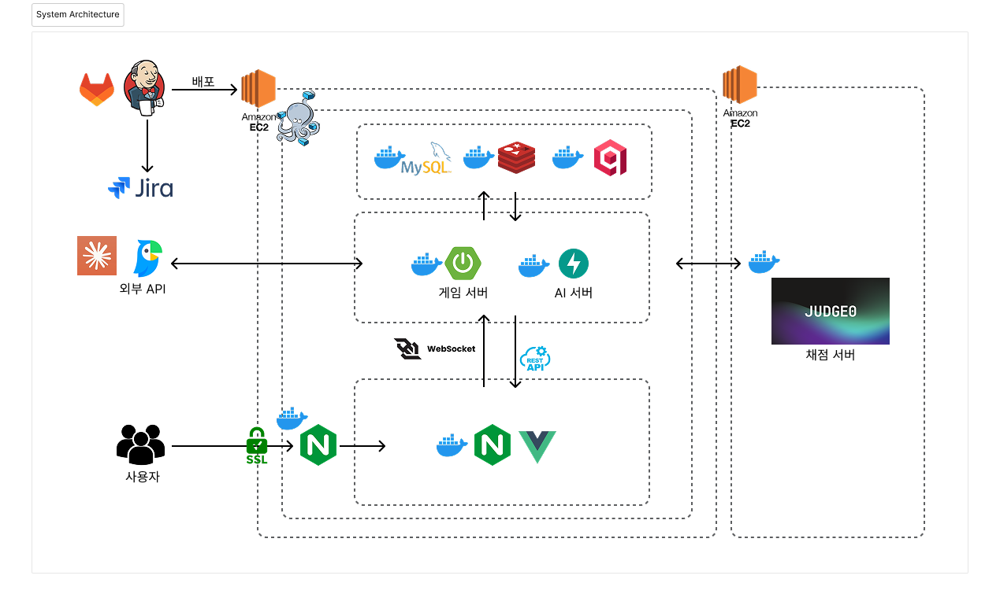

# RoomInCode: 실시간 코딩 대결 플랫폼

RoomInCode는 실시간 코딩 대결 플랫폼으로, 단순한 알고리즘 풀이를 넘어 AI와 1:1로 대결하거나 친구들과 함께 코딩 문제를 해결하며 실력을 겨룰 수 있습니다.

## 💡 프로젝트

### 🗓️ 기간

2026.01.06-2026.02.09

### ‍👩‍👧‍👦 팀

|역할|이름|전공 여부|
|:-----|:-----|:-----:|
|팀장, FE|[권이삭](https://github.com/kys-0602)|전공|
|팀원, BE|[우기주](https://github.com/Wjadebead)|전공|
|팀원, AI, INFRA|[최다은](https://github.com/thisischeese)|전공|
|팀원, FE|[김혜원](https://github.com/zheldgkwk)|비전공|
|팀원, BE|[이수빈](https://github.com/subbb-in)|비전공|
|팀원, BE|[차윤선](https://github.com/hisunny1007)|비전공|

### 🗂️ 산출물

|NOTION|FIGMA(Wireframe)|ERD|Video|
|:-----|:-----|:-----|:-----|
|[Notion](https://www.notion.so/2dadaee1798180b38904e95a3a5411ad)|[Figma](https://www.figma.com/design/IEmApwJf4bKuyhlGsTn9Eu/%EA%B3%B5%ED%86%B5-pjt%EC%9A%A9-%EC%99%80%EC%9D%B4%EC%96%B4%ED%94%84%EB%A0%88%EC%9E%84?node-id=48-45&p=f)|[ERD](https://www.erdcloud.com/d/NEcR4wBo22Nu6ioQ8)|[Youtube](https://youtu.be/S9Xy-O9BC5I)|

### ✨ 주요 기능

|🤖 AI 모드|👥 친구 대결|🏆 컨테스트|
|:-----|:-----|:-----|
|- 사용자가 선택한 난이도와 프로그래밍 언어에 맞춰 AI 봇과 실시간으로 알고리즘 문제를 풀 수 있습니다.<br>- AI가 코드를 작성하는 모습을 실시간 스트리밍처럼 자연스럽게 시각화합니다.<br>- 대결 종료 후 AI가 사용자의 코드를 분석하여 효율성, 가독성 등에 피드백을 제공합니다.|- 친구와 실시간으로 동일한 문제를 풀며 경쟁할 수 있습니다.<br>- 이모지 반응과 실시간 상태 공유를 통해 긴장감 넘치는 대결을 즐길 수 있습니다.|- 다수의 참가자가 동시에 문제를 풀고, 실시간 리더보드를 통해 순위를 확인할 수 있습니다.|

### 🛠 기술 스택


|FE|BE|AI|INFRA|
|:-----|:-----|:-----|:-----|
|- Vue.JS<br>- TypeScript<br>- Vite<br>- Pinia<br>- Naive UI<br>- TailwindCSS<br>- Monaco Editor<br>- Yjs<br>- y-monaco<br>- y-websocket<br>- Axios<br>- WebSocket<br>- Chart.js|- SpringBoot<br>- MySQL<br>- Redis<br>- MyBatis<br>- Spring Security<br>- OAuth2<br>- JWT<br>- JavaMailSender|- FastAPI<br>- Pandas<br>- Datasets<br>- PyTorch/Transformers|- Docker<br>- Docker Compose<br>- Jenkins<br>- EC2|

### 💽 시스템 아키텍쳐



---

## 🚀 시작하기

### 사전 요구사항
- Node.js 20+
- Java JDK 21
- Python 3.11
- Docker & Docker Compose
- MySQL & Redis

### 설치 및 실행

1. **저장소 클론**
   ```bash
   git clone https://github.com/SSAFY/S14P11A208.git
   cd S14P11A208
   ```

2. **환경 변수 설정**
   - `fe/.env` 및 `be/src/main/resources/application.properties` 등을 환경에 맞게 설정합니다.
   - `exec`의 문서 내용을 참고해주세요.

3. **Backend 실행**
   ```bash
   cd be
   ./gradlew bootRun
   ```

4. **Frontend 실행**
   ```bash
   cd fe
   npm install
   npm run dev
   ```

5. **AI 서버 실행**
   ```bash
   cd ai
   pip install -r requirements.txt
   uvicorn app.main:app --reload
   ```

6. **전체 실행 (Docker Compose)**
   ```bash
   docker-compose up -d --build
   ```
